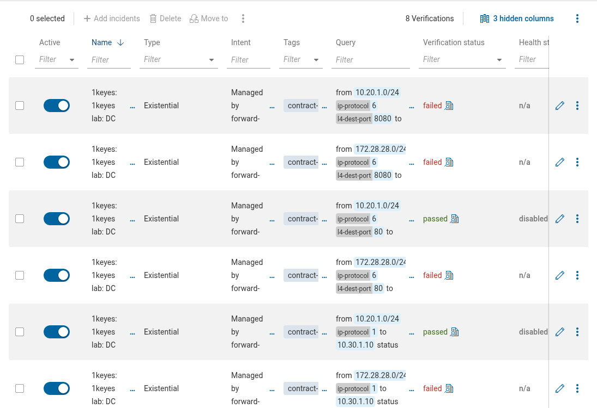

# forward-1keyes

Turns ThousandEyes tests into Forward Networks intent checks.

It reads the tests in a ThousandEyes account group, works out which flow each one probes
(source agent, destination, protocol, port), locates both ends in a Forward network snapshot, and
creates the matching checks in Forward. Nothing is written until you have read a plan and approved
its digest.

Status: a prototype. Agent-to-server (ICMP, TCP, HTTP) and agent-to-agent tests are mapped.
Tests from ThousandEyes cloud agents are reported but not turned into checks yet.

## Guide

The [guide](guide/README.md) has screenshots from a real lab network, an
[operations runbook](guide/runbook.md), a [lab runbook](guide/lab-runbook.md),
[webhooks](guide/webhooks.md) in both directions and [use cases](guide/use-cases.md).

## Builds and releases

GitHub Actions tests every change on Linux, macOS and Windows. A release is built from a version
tag for each of the three on amd64 and arm64: `.tar.gz` for Linux and macOS, `.zip` for Windows,
with `SHA256SUMS`. Each archive is run on a matching machine before it is published. No release
has been published yet. The binaries will not be code-signed or notarized, so macOS and Windows
may warn before running them.

On Windows the owner-only mode of the files the tool writes (the plan file) is not enforced; keep
them in a folder only you can read.

## Build

    go build -o forward-1keyes ./src/cmd/forward-1keyes

## Configuration

Secrets come from the environment only. No flag takes a secret or a host.

| Variable | Meaning |
| :--- | :--- |
| `TE_API_TOKEN` | ThousandEyes API token. Sent only to `api.thousandeyes.com`. |
| `FWD_URL` | Forward base URL, https. |
| `FWD_USER`, `FWD_PASS` | Forward credentials (basic auth, sent only to that host's `/api`). |

## Use

    forward-1keyes plan --network "<Forward network>" --te-account-group "<account group>"
    forward-1keyes apply --plan forward-1keyes.plan.json --digest sha256:<hex>
    forward-1keyes status --network "<Forward network>"
    forward-1keyes report --network "<Forward network>" --te-account-group "<account group>"
    forward-1keyes changes --network "<Forward network>" --te-account-group "<account group>" [--notify] [--state FILE]
    forward-1keyes listen --network "<Forward network>" --te-account-group "<account group>"
    forward-1keyes record --te-account-group "<account group>" --out thousandeyes.rec.json [--window 1h] [--force]
    forward-1keyes report --network "<Forward network>" --te-account-group "<account group>" --te-replay thousandeyes.rec.json

- `plan` only reads. It writes a plan file (mode 600) and prints its digest. Selection flags
  (`--test-id`, `--include-name`, `--exclude-label`, ...) narrow the tests; `--max-flows` caps the size.
- `apply` re-reads ThousandEyes and Forward, refuses if the plan file, its digest, or the world
  has changed since you approved it, and then writes in batches.
- `report` only reads. It puts each check's latest ThousandEyes measurement beside its Forward status
  and says where to look first.
- `changes` only reads ThousandEyes and Forward (with `--state` it also writes that one small file). It lists the checks that broke or recovered since the previous snapshot, and
  with `--notify` posts one signed message to the https URL in `NOTIFY_URL`. With `--state FILE` it
  remembers the last snapshot it finished with, so a timer repeats nothing and misses nothing; see `deploy/`.
- `listen` receives a ThousandEyes alert webhook on loopback (put HTTPS in front of it) and answers with
  what Forward models for the alerted test: one signed message per alert to `NOTIFY_URL`. It needs
  `ALERT_TOKEN` (at least 32 characters) and only reads. See [webhooks](guide/webhooks.md).
- `record` reads ThousandEyes (and resolves the test targets' names) and saves what the tool decoded to a
  file (mode 600, written only if every read succeeded; `--force` replaces an existing file). It does not
  contact Forward. The file holds test names, targets and internal addresses: treat it like the plan file.
  A web test's URL is saved as scheme, host and port only (no user, path, query or fragment), which is all
  the tool reads from it.
- `--te-replay <file>` on `plan`, `apply`, `report`, `changes` and `listen` uses that file as the only source of
  ThousandEyes data and name lookups: no token is read and nothing is resolved (`--resolver` is refused).
  The window is measured back from the time of the recording, not from now, and cannot be longer than the
  recorded one. Every output says the data is a recording and when it was made. A plan made from a
  recording applies only with `--te-replay` naming the same file, and a plan made from live data refuses
  `--te-replay`. A recording made for another account group is refused. Forward is still read (and written by
  `apply`) as without it, so it must be reachable and hold a network that matches the recorded addresses.
- `status` lists the checks the tool manages and flags any with a malformed ownership tag set.

## How checks are owned

Each check carries tags that record where it came from: a contract version, the managing tool,
the ThousandEyes account, and a source key (a hash of test, slot, protocol and port). A later
plan matches on that key, so a renamed test updates its check and a removed test marks its check
stale. The tool never deletes a check and never deactivates one; HTTP DELETE is refused by the
client.

## Limits found against a live Forward

- A location filter takes one value, so a destination with several addresses, or an agent in
  several prefixes, becomes one check per address and per prefix. Such a check's key carries the
  destination address; every other key is unchanged.
- If two checks would still end up with one key (a reverse-direction agent-to-agent test with
  senders in different subnets), each of their keys carries its destination too. Gaining or losing
  such a sender replaces the earlier check: `plan` shows it `stale` and creates new ones.
- Forward's model has connected subnets, not end hosts, so a destination is located by subnet.
- An agent's every modelled address becomes a source. `--ignore-agent-subnet <CIDR>` leaves out,
  for example, a management subnet. When one agent gives a test more than one source, `plan` warns on
  standard error, says which were seen sending in the last hour, and may suggest the flag. It
  changes nothing itself, and not being seen does not prove a prefix unused. See the
  [runbook](guide/runbook.md#the-warning-about-more-than-one-source).
- "From the internet" needs the network's internet node to have a connection; its check form is
  not verified. A test from a cloud agent is reported as not importable, with the reason that the
  network's internet node has no connection when that is the case.

## Tests

    go vet ./... && go test -count=1 ./...
