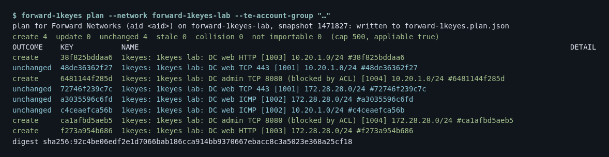
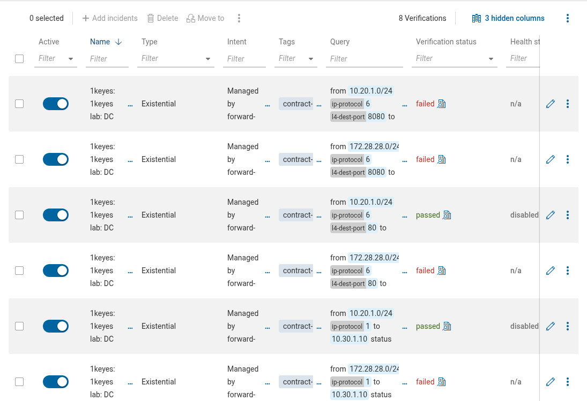
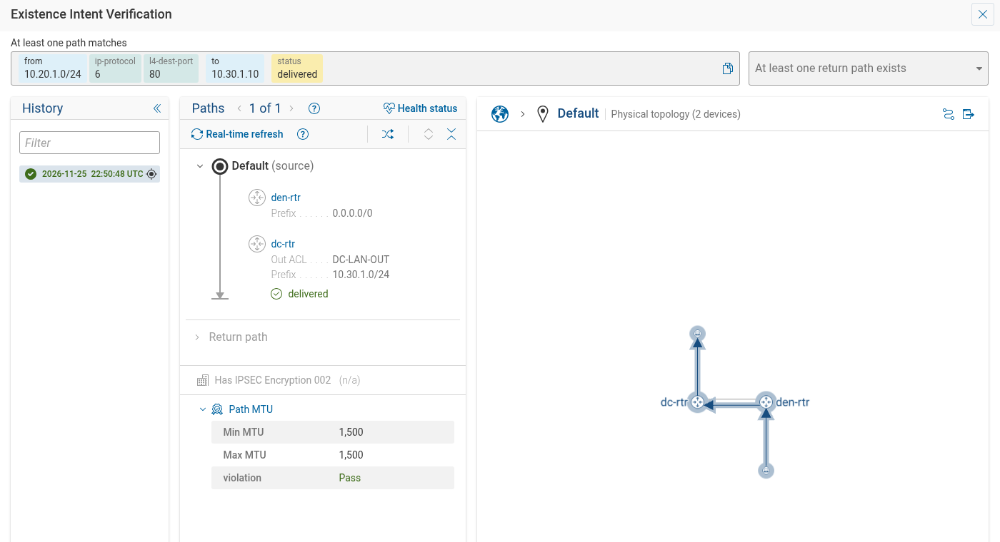
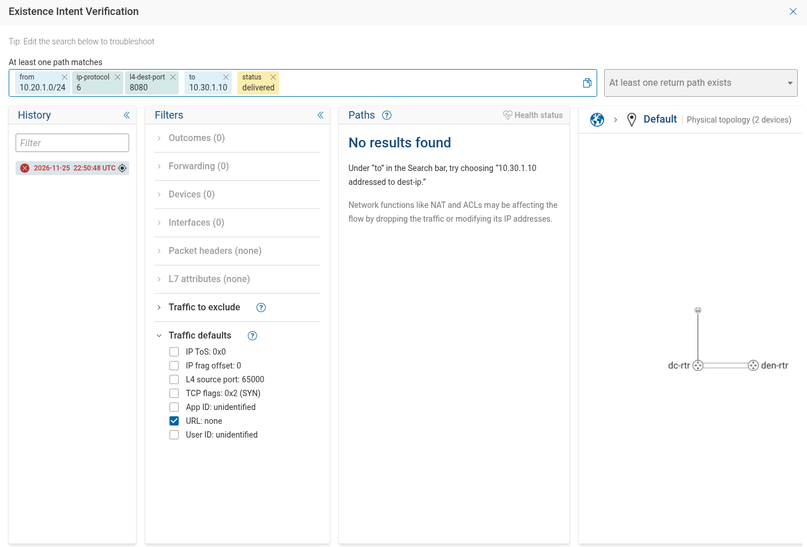
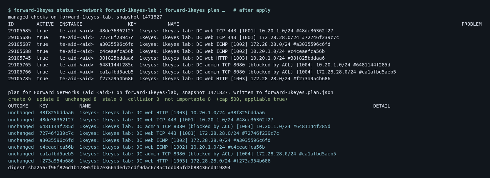
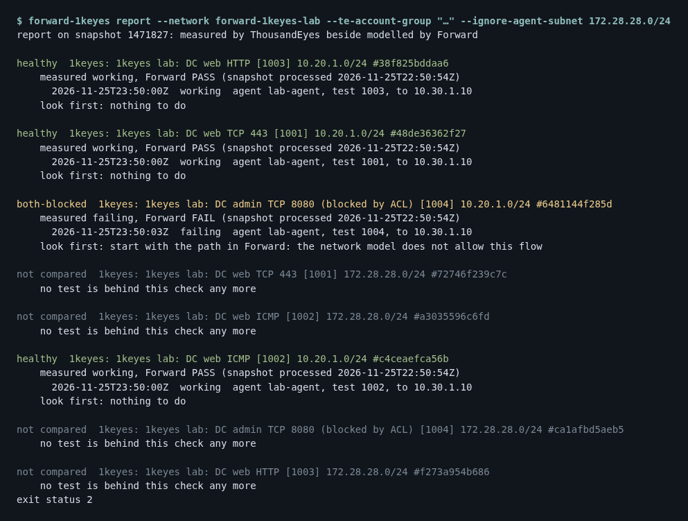
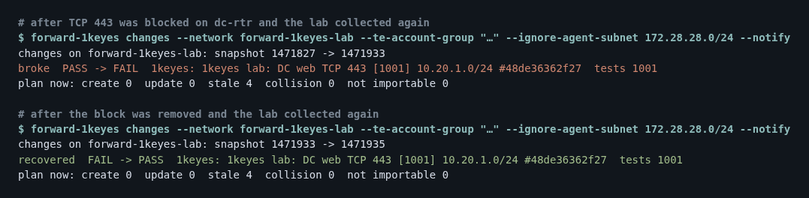

# forward-1keyes guide

| Read | For |
| :--- | :--- |
| [Operations runbook](runbook.md) | Installing, planning, approving, applying, checking and troubleshooting |
| [Lab runbook](lab-runbook.md) | Building a real network with a ThousandEyes agent and collecting it into Forward |
| [Use cases](use-cases.md) | What works today in both directions, and what could be built next, including webhooks |

## What it looks like

ThousandEyes tests, planned as Forward intent checks:

The checks in Forward, evaluated against the network model:

A passing check shows the path Forward computed, including the access list it passes through:

A check for a port the access list blocks finds no delivered path:

After apply, `status` lists the managed checks and a second `plan` has nothing to do:

Account and test identifiers in the images are replaced with placeholders.

`report` puts what was measured beside what was modelled:

`changes` says what flipped between two snapshots, and can notify:

## Proof from a real network

From the [lab](lab-runbook.md): the same flows, measured by a ThousandEyes agent sending real
traffic, and evaluated by Forward from device configuration and state.

| Test from the branch agent to 10.30.1.10 | ThousandEyes (real traffic) | Forward (network model) |
| :--- | :--- | :--- |
| TCP 443 | 0% loss | PASS |
| ICMP | 0% loss | PASS |
| HTTP | response code 200 | PASS |
| TCP 8080, blocked by an access list | "Host is unreachable" | FAIL |

The agent's own traceroute (10.20.1.1, 10.0.1.2, 10.30.1.10) matches the Forward path
(den-rtr, then dc-rtr). This is one small lab and four tests, not a general accuracy claim.

The same run also made four checks from the lab's management network, because the agent has a
management address too. Those fail, correctly for that source, but no test takes that path.
Planning with `--ignore-agent-subnet 172.28.28.0/24` leaves that address out: the four real
checks stay unchanged and the four others show as stale. See the
[runbook](runbook.md#a-check-from-an-address-the-test-does-not-use).
