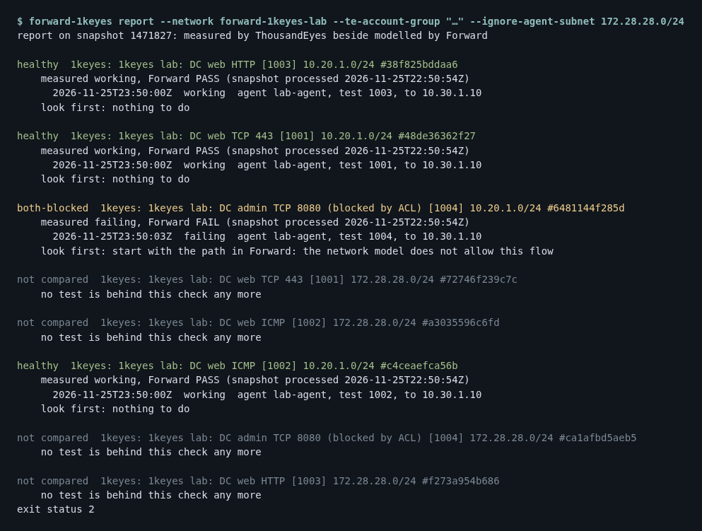
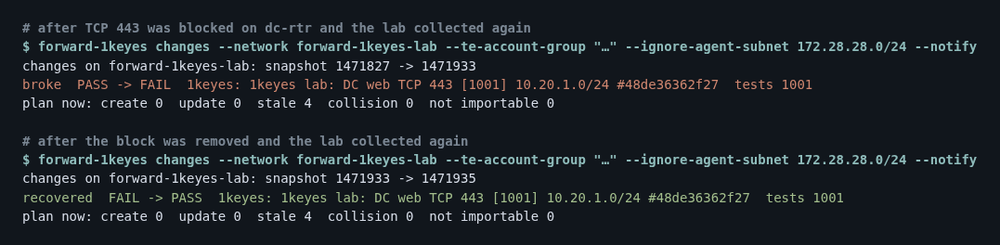
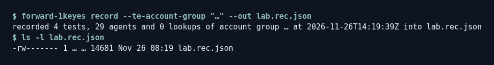
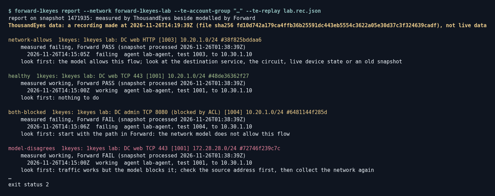
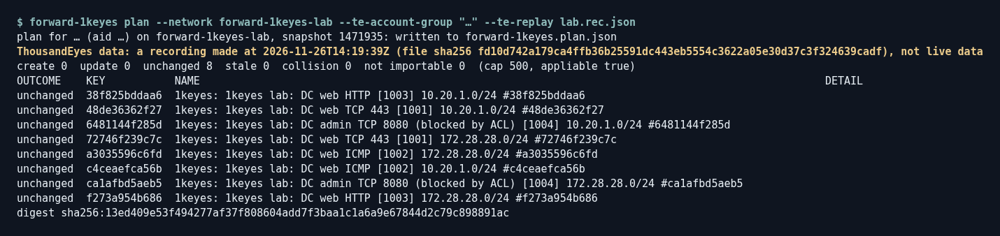
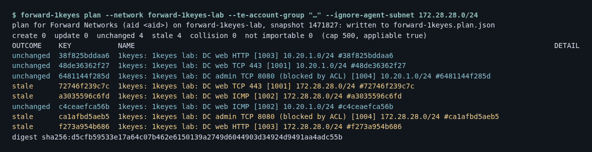

# Operations runbook

## Before you start

- Go (to build). A ThousandEyes API token with read access to the account group. A Forward login
  with rights to read the network and to create checks.
- Secrets come from the environment only:

| Variable | Meaning |
| :--- | :--- |
| `TE_API_TOKEN` | ThousandEyes API token, sent only to `api.thousandeyes.com` |
| `FWD_URL` | Forward base URL (https) |
| `FWD_USER`, `FWD_PASS` | Forward credentials, sent only to that host's `/api` |

Keep them in a file with mode 600 outside the repository, and load it with
`set -a; . FILE; set +a`.

    go build -o forward-1keyes ./src/cmd/forward-1keyes

## Routine run

1. **Plan.** Reads only.

       forward-1keyes plan --network "<Forward network>" --te-account-group "<account group>"

   Useful flags: `--test-id`, `--include-name`, `--exclude-name`, `--include-label`,
   `--exclude-label`, `--ignore-agent-subnet CIDR`, `--max-flows` (default 500), `--resolver ip:port`,
   `--json`.
   `forward-1keyes plan --help` lists them all.

2. **Review the table.** For every row check the outcome, and the source prefix in the name.

   | Outcome | Meaning |
   | :--- | :--- |
   | create | a new check |
   | update | an existing managed check whose content changed |
   | unchanged | nothing to do |
   | stale | a managed check with no test behind it any more; it is left in place |
   | collision | something stands in the way: the name is already taken, two managed checks share a key, or a managed check's tags are malformed or from a newer version |
   | not_importable | the test cannot be made into a check; the row says why |

3. **Approve and apply** with the digest the plan printed:

       forward-1keyes apply --plan forward-1keyes.plan.json --digest sha256:<hex>

   `apply` reads both systems again and refuses if the plan file, the digest or the world
   changed since the plan. If it refuses, plan again and review again.

4. **Verify.**

       forward-1keyes status --network "<Forward network>"

   Then run `plan` once more: applied checks read `unchanged`.

5. **Read the results** in Forward under Verify, Intent. Managed checks are named
   `1keyes: <test name> [<test id>] <source> #<key>`.

## Compare what was measured with what is modelled

    forward-1keyes report --network "<Forward network>" --te-account-group "<account group>"

`report` only reads. It takes the same selection, `--resolver` and `--ignore-agent-subnet` flags as
`plan`, plus `--window` (how far back to read measurements, default `1h`), `--json` and
`--out FILE`.

For each check it takes the latest network result per test, agent and destination. A result with
an error, or 100% loss, is failing; 0% loss is working; anything between is degraded. A result with
neither is unknown, never working.

| Verdict | Look first at |
| :--- | :--- |
| healthy | nothing to do |
| both-blocked | the path in Forward |
| network-allows | the destination service, the circuit, live device state, or an old snapshot |
| model-disagrees | the check's source address, then collect the network again |
| inconclusive | the records: no data, disagreeing agents, **any** partial loss, no pass or fail in Forward, or an outdated result |

- **Any loss at all makes a check inconclusive**, even 2%. In the lab, one five-minute round showed
  2% and 6% loss while the machine running it was busy, and the next round was clean.
- Each row shows when it was measured and when the snapshot was processed, and says when a
  measurement is older than the snapshot.
- ThousandEyes results do not say which source address an agent used. An agent with several
  modelled addresses has one check per address, all judged against the same measurement. Use
  `--ignore-agent-subnet`.
- Agent-to-agent checks are listed but not compared yet. Stale checks and tests without a check are
  listed with the reason.

Exit status: **0** only when something was compared and every compared check is healthy; **2** for
any other result, including nothing to compare; **1** on an error. A result that cannot be read or
decoded is an error, never "no data".

## What changed since the last snapshot, and a notification

    forward-1keyes changes --network "<Forward network>" --te-account-group "<account group>"

`changes` only reads ThousandEyes and Forward. It compares your managed checks on the latest
processed snapshot with the one before it, or with `--since <snapshot ID>`. Predictions and drafts
are never compared. It takes the same selection, `--resolver` and `--ignore-agent-subnet` flags as
`plan`, plus `--json`.

| Change | Meaning |
| :--- | :--- |
| broke | PASS became FAIL |
| recovered | FAIL became PASS |
| added | only on the newer snapshot; its status is shown |
| removed | only on the older snapshot. Deleting a check in Forward removes it from that snapshot on; older ones keep it |
| changed | any other change of status |
| unknown | a result is outdated on either side, so it is never called broke or recovered |

Each change names the ThousandEyes tests behind the check, and the last line counts what `plan` would
do now.

### Notifications

    NOTIFY_URL=https://... forward-1keyes changes ... --notify

With `--notify`, one JSON message is posted when there is a change, or a create, update, stale or
collision row. It has a `text` summary (so a chat incoming webhook can show it), `from`, `to`,
`changes` and `plan`.

- `NOTIFY_URL` comes from the environment only, must be https, and is treated as a secret: it is never
  printed or logged, and a redirect is not followed. The notification carries no ThousandEyes or
  Forward credential.
- With `NOTIFY_SECRET` set, the header `X-1keyes-Signature: sha256=<hex>` is the HMAC-SHA256 of the
  exact body. A receiver should compute it and compare before trusting a message.
- A delivery that is not answered with 2xx makes the run exit 1. There is no retry.
- Check names, test IDs and statuses go to whatever address you set. Choose it accordingly.

### Running it

It stores nothing and runs no server: run it from a timer, or from whatever handles a Forward webhook
for a processed snapshot. To avoid repeats, and not to miss a change when several snapshots arrived,
remember the `to` of the last run and pass it as `--since`:

    last=$(cat last-snapshot 2>/dev/null)
    forward-1keyes changes ... --json ${last:+--since "$last"} --notify > changes.json
    status=$?
    [ "$status" -ne 1 ] && jq -r .to changes.json > last-snapshot

If no newer snapshot has arrived, `--since` equal to the latest is refused with exit 1; treat that as
nothing new. A change that breaks and recovers between two runs does not show. A standing stale check
is reported on every run until you delete it.

Exit status: **0** when two snapshots were compared and there is nothing to tell; **2** when there is
a change or waiting work, or only one snapshot; **1** on an error. A failed read is an error, never
"no change", and nothing is sent.

## Record ThousandEyes data and replay it

Use this when a demo has to work without ThousandEyes: the trial has ended, the lab agent is off, or
there is no route to `api.thousandeyes.com`.

    forward-1keyes record --te-account-group "<account group>" --out thousandeyes.rec.json

`record` reads ThousandEyes and resolves the test targets' names. It does not contact Forward and
needs no Forward variable. It saves what the tool decoded (never the API's responses, a token or a
header), and a test URL loses its user, query and fragment. The file is mode 600 and is written only
after every read succeeded, so a failed run leaves no file and an existing file untouched. Replacing
one needs `--force`. On a filesystem that cannot make a hard link (some network mounts) use `--force`
as well. Treat the file like the plan file: it holds test names, targets and internal addresses.

Then add `--te-replay <file>` to `plan`, `apply`, `report` or `changes`:

    forward-1keyes report --network "<Forward network>" --te-account-group "<account group>" \
      --te-replay thousandeyes.rec.json

- **No ThousandEyes, no DNS.** `TE_API_TOKEN` is not read, no ThousandEyes client is built and nothing
  is resolved; `--resolver` with `--te-replay` is refused. Forward is still read, and written by
  `apply`, exactly as without it, so it must be reachable and hold a network that matches the
  recorded addresses.
- **Time is the recording's.** `--window` counts back from when the recording was made, never from
  now, and a window longer than the recorded one is refused. Measurement times are shown as recorded.
  Beside a newer snapshot a replay can show a disagreement that no longer means anything.
- **It never looks live.** A line near the top of the plan, report and changes output, their JSON, the report file and the notification all say the data is a recording, with the
  time and the file's SHA-256. This cannot be turned off.
- **A plan remembers its source.** A plan made from a recording stores the file's SHA-256 and recording
  time inside what its digest covers.

  `apply` then refuses the plan unless `--te-replay` names a file with that SHA-256, and refuses
  `--te-replay` for a plan made from live data. A plan made from live data is unchanged.
- **The file is untrusted input.** It is refused when it is over 64 MiB, has an unknown format,
  version or field, has data after the JSON, holds a value the live reader would reject, or was made
  for another account group.

## Removing or backing out

The tool never deletes or deactivates a check, and its HTTP client refuses DELETE. To remove
checks, delete them in the Forward UI. They are identified by the tag
`managed-by:com.forward.1keyes`.

## Troubleshooting

| What you see | Likely cause and action |
| :--- | :--- |
| `not_importable`: the destination is outside the modelled network | No collected interface has a subnet holding the address. Collect the device that connects it. |
| `not_importable`: the network's internet node has no connection to the model | The test runs from a ThousandEyes cloud agent. See below. |
| `not_importable`: the agent is not in the modelled network | The agent's address is in no collected subnet. |
| `not_importable`: a test is disabled | Enable it in ThousandEyes if you want it checked. |
| ThousandEyes refuses a test to a private address: "Can only use private BGP Monitors for a local address" | Create the test with BGP measurements off. |
| `apply` refuses with a digest or drift message | Something changed after the plan. Plan again. |
| A check FAILs while ThousandEyes shows the path working | Check the source prefix in the name first, then whether the model is current (collect again). |

Add `--debug` to log each request's method, path, status and duration. `--debug-bodies` adds
bodies with secrets removed.

### A check from an address the test does not use

ThousandEyes reports every address of an agent. If more than one of them is in the Forward model,
for example a management address on a collected management network, each one gives a check. Look
at the source prefix in the plan table before applying, and leave the unwanted subnet out:

    forward-1keyes plan ... --ignore-agent-subnet 172.28.28.0/24

The flag is repeatable. It removes **agent** addresses inside the prefix before the agent is
located, wherever an agent is used: as a source, as an agent-to-agent target, or as the
destination of a return test. It never filters a test's destination host. An agent left with no
address is reported as not importable. The plan file records the prefixes, so the digest you
approve covers them.

Use the same flag on every later plan. Checks already applied from an ignored subnet are shown as
`stale` and left in Forward; delete them in the Forward UI if you want them gone:

### Cloud agents

A cloud agent's traffic starts on the internet. Turning that into a check needs the Forward
network's internet node to be connected to the model, and a verified way to express an internet
source. Neither is established, so these tests are reported and never turned into checks.

## Running it on a schedule

`plan` only reads, so it is safe to schedule and compare. Keep `apply` behind a person who
has read the plan: it needs the digest of exactly what was reviewed.
