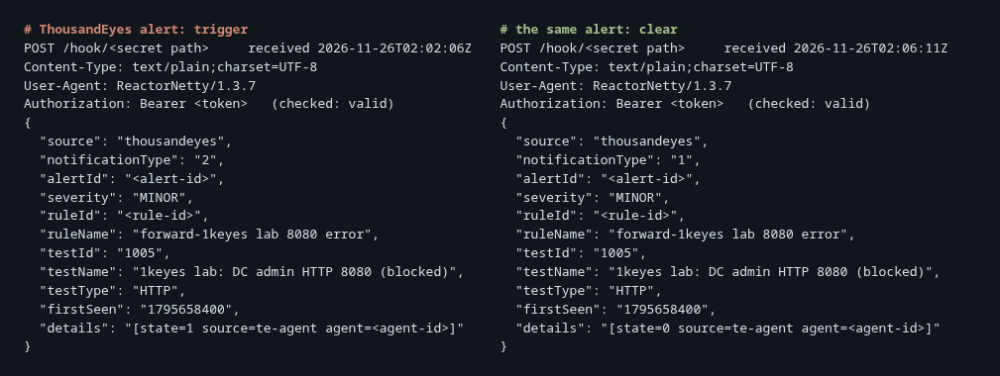

# Webhooks, both directions

Both were run in the [lab](lab-runbook.md) through a temporary public HTTPS tunnel to a small
capture receiver (`../lab/webhook/capture.py`).

| Direction | What | State |
| :--- | :--- | :--- |
| forward-1keyes to you | `changes --notify` posts what flipped between two snapshots | Built; delivered over public HTTPS with a valid signature |
| ThousandEyes to you | an alert posts to a webhook | Set up by API and captured, trigger and clear; **forward-1keyes does not receive it yet** |

## A temporary public address

For a test only. A quick tunnel gets a new random address each start, has no uptime promise, and is
reachable by anyone who learns it.

    mkdir -m 700 hook && cd hook
    for f in path bearer sign; do python3 -c "import secrets;print(secrets.token_urlsafe(32))" > $f.secret; done
    chmod 600 *.secret
    python3 -I /path/to/lab/webhook/capture.py . 8644 &
    cloudflared tunnel --no-autoupdate --url http://127.0.0.1:8644

The public address is in cloudflared's output. The receiver answers only
`https://<name>.trycloudflare.com/hook/<path.secret>`; everything else is 404.

**Stop both when you finish**, and delete whatever you pointed at the address.

## Notifications from forward-1keyes

    NOTIFY_URL="https://<name>.trycloudflare.com/hook/$(cat path.secret)" \
    NOTIFY_SECRET="$(cat sign.secret)" \
    forward-1keyes changes --network "<Forward network>" --te-account-group "<account group>" --notify

`received.jsonl` then shows `"signature": "valid"` and no bearer token: a notification carries no
ThousandEyes or Forward credential. The message and its rules are in the
[runbook](runbook.md#notifications).

## ThousandEyes alerts

### What ThousandEyes sent

| Point | Observed |
| :--- | :--- |
| Authentication | the connector's bearer token arrived in `Authorization` and matched |
| Signature | none was sent, and none was found in the documentation: authenticate with the token or a custom header, over HTTPS |
| Content type | `text/plain;charset=UTF-8`, although the body is JSON. **A receiver must not require `application/json`** |
| Trigger and clear | `{{type.id}}` was `2` for the trigger and `1` for the clear, with the same alert id; the detail's state went from 1 to 0 |
| Delay | the trigger arrived about a minute after the failing test round |

### Setup by API

All three calls below succeeded on a trial account (`https://api.thousandeyes.com`, bearer API
token). The vendor's [custom webhook documentation](https://docs.thousandeyes.com/product-documentation/integration-guides/custom-webhooks.md)
describes the same objects in the UI.

1. **Connector**, where to send and how to authenticate. `POST /v7/connectors/generic`

       {"type": "generic", "name": "<name>", "target": "https://<address>/hook/<secret>",
        "authentication": {"type": "bearer-token", "token": "<bearer secret>"}}

2. **Webhook operation**, what to send. `POST /v7/operations/webhooks`

       {"name": "<name>", "enabled": true, "category": "alerts", "status": "pending", "type": "webhook",
        "payload": "<a Handlebars template, as one string>"}

   The template used in the lab:

       {"source":"thousandeyes","notificationType":"{{type.id}}","alertId":"{{alert.id}}",
        "severity":"{{alert.severity.id}}","ruleId":"{{alert.rule.id}}","ruleName":"{{alert.rule.name}}",
        "testId":"{{alert.test.id}}","testName":"{{alert.test.name}}","testType":"{{alert.test.testType}}",
        "firstSeen":"{{alert.firstSeen.epochSecond}}",
        "details":"{{#alert.details}}[state={{state.id}} source={{source.name}} agent={{source.id}}]{{/alert.details}}"}

   How the template escapes a quote or a backslash inside a test name was not tested. Do not assume
   the body is valid JSON for every name.

   Then link the two: `PUT /v7/operations/webhooks/<operation id>/connectors` with a **plain list**,
   `["<connector id>"]`. An object such as `{"items": [...]}` is refused.

3. **Alert rule** that uses the operation. `POST /v7/alerts/rules`

       {"ruleName": "<name>", "alertType": "http-server", "expression": "((probDetail != \"\"))",
        "roundsViolatingOutOf": 1, "roundsViolatingRequired": 1, "roundsViolatingMode": "any",
        "minimumSources": 1, "severity": "minor", "notifyOnClear": true, "testIds": ["<test id>"],
        "notifications": {"customWebhook": [{"integrationId": "<operation id>",
                                             "integrationType": "custom-webhook"}]}}

To remove it all: delete the alert rule, then the operation, then the connector.

### A hard block can slip past a loss alert

The first rule tried was a network rule, `((loss >= 50%))`, on the TCP test to the blocked port.
**It raised nothing.** That test's results carry no loss figure at all, only
`errorDetails: "Host is unreachable"`, and no alert appeared in over ten minutes. An HTTP test to
the same port with `((probDetail != ""))` alerted at its first round. If you rely on alerts for
blocked paths, check that your rules fire on errors and not only on loss.

## What a receiver would still need

A receiver that turns an alert into "does the network model allow this flow?" is not built. From
what was captured it would have to:

- require HTTPS on a stable address, and compare the bearer token in constant time before reading
  anything else;
- accept the body whatever content type it is labelled with, limit its size, and treat every field as
  untrusted;
- use only the test id to look up managed checks, then read their status and path from Forward;
- cope with the same alert arriving more than once, since ThousandEyes retries failed deliveries.
