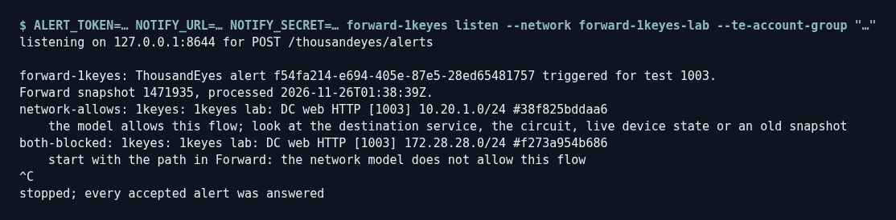
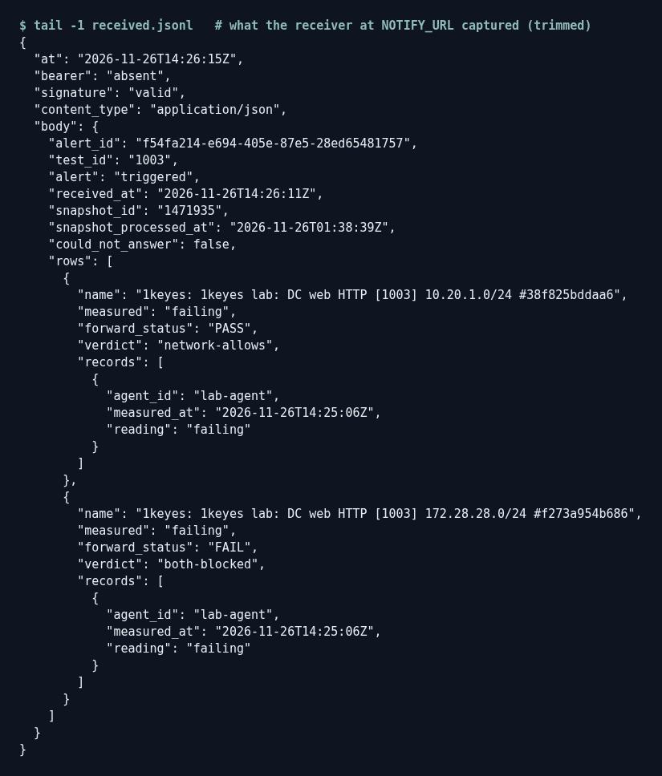
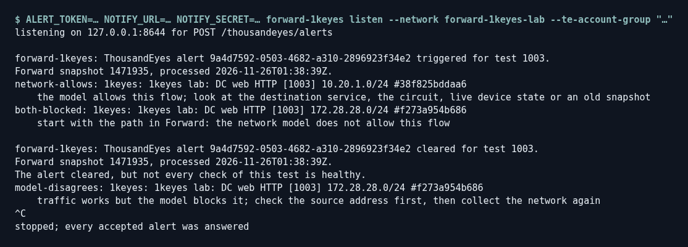

# Webhooks, both directions

Both were run in the [lab](lab-runbook.md) through a temporary public HTTPS tunnel to a small
capture receiver (`../lab/webhook/capture.py`).

| Direction | What | State |
| :--- | :--- | :--- |
| forward-1keyes to you | `changes --notify` posts what flipped between two snapshots | Built; delivered over public HTTPS with a valid signature |
| ThousandEyes to you | an alert posts to a webhook | Set up by API and captured, trigger and clear; answered by `forward-1keyes listen` (below) |

## A temporary public address

For a test only. A quick tunnel gets a new random address each start, has no uptime promise, and is
reachable by anyone who learns it.

    mkdir -m 700 hook && cd hook
    for f in path bearer sign; do python3 -c "import secrets;print(secrets.token_urlsafe(32))" > $f.secret; done
    chmod 600 *.secret
    python3 -I /path/to/lab/webhook/capture.py . 8644 &
    cloudflared tunnel --no-autoupdate --url http://127.0.0.1:8644

The public address is in cloudflared's output. The receiver answers only
`https://<name>.trycloudflare.com/hook/<path.secret>`; everything else is 404.

**Stop both when you finish**, and delete whatever you pointed at the address.

## Notifications from forward-1keyes

    NOTIFY_URL="https://<name>.trycloudflare.com/hook/$(cat path.secret)" \
    NOTIFY_SECRET="$(cat sign.secret)" \
    forward-1keyes changes --network "<Forward network>" --te-account-group "<account group>" --notify

`received.jsonl` then shows `"signature": "valid"` and no bearer token: a notification carries no
ThousandEyes or Forward credential. The message and its rules are in the
[runbook](runbook.md#notifications).

## ThousandEyes alerts

### What ThousandEyes sent

| Point | Observed |
| :--- | :--- |
| Authentication | the connector's bearer token arrived in `Authorization` and matched |
| Signature | none was sent, and none was found in the documentation: authenticate with the token or a custom header, over HTTPS |
| Content type | `text/plain;charset=UTF-8`, although the body is JSON. **A receiver must not require `application/json`** |
| Trigger and clear | `{{type.id}}` was `2` for the trigger and `1` for the clear, with the same alert id; the detail's state went from 1 to 0 |
| Delay | the trigger arrived about a minute after the failing test round |

### Setup by API

All three calls below succeeded on a trial account (`https://api.thousandeyes.com`, bearer API
token). The vendor's [custom webhook documentation](https://docs.thousandeyes.com/product-documentation/integration-guides/custom-webhooks.md)
describes the same objects in the UI.

1. **Connector**, where to send and how to authenticate. `POST /v7/connectors/generic`

       {"type": "generic", "name": "<name>", "target": "https://<address>/hook/<secret>",
        "authentication": {"type": "bearer-token", "token": "<bearer secret>"}}

2. **Webhook operation**, what to send. `POST /v7/operations/webhooks`

       {"name": "<name>", "enabled": true, "category": "alerts", "status": "pending", "type": "webhook",
        "payload": "<a Handlebars template, as one string>"}

   The template used in the lab:

       {"source":"thousandeyes","notificationType":"{{type.id}}","alertId":"{{alert.id}}",
        "severity":"{{alert.severity.id}}","ruleId":"{{alert.rule.id}}","ruleName":"{{alert.rule.name}}",
        "testId":"{{alert.test.id}}","testName":"{{alert.test.name}}","testType":"{{alert.test.testType}}",
        "firstSeen":"{{alert.firstSeen.epochSecond}}",
        "details":"{{#alert.details}}[state={{state.id}} source={{source.name}} agent={{source.id}}]{{/alert.details}}"}

   How the template escapes a quote or a backslash inside a test name was not tested. Do not assume
   the body is valid JSON for every name.

   Then link the two: `PUT /v7/operations/webhooks/<operation id>/connectors` with a **plain list**,
   `["<connector id>"]`. An object such as `{"items": [...]}` is refused.

3. **Alert rule** that uses the operation. `POST /v7/alerts/rules`

       {"ruleName": "<name>", "alertType": "http-server", "expression": "((probDetail != \"\"))",
        "roundsViolatingOutOf": 1, "roundsViolatingRequired": 1, "roundsViolatingMode": "any",
        "minimumSources": 1, "severity": "minor", "notifyOnClear": true, "testIds": ["<test id>"],
        "notifications": {"customWebhook": [{"integrationId": "<operation id>",
                                             "integrationType": "custom-webhook"}]}}

To remove it all: delete the alert rule, then the operation, then the connector.

### A hard block can slip past a loss alert

The first rule tried was a network rule, `((loss >= 50%))`, on the TCP test to the blocked port.
**It raised nothing.** That test's results carry no loss figure at all, only
`errorDetails: "Host is unreachable"`, and no alert appeared in over ten minutes. An HTTP test to
the same port with `((probDetail != ""))` alerted at its first round. If you rely on alerts for
blocked paths, check that your rules fire on errors and not only on loss.

## Answering an alert: `listen`

`forward-1keyes listen` receives the alert and answers the question "is the network meant to allow
that flow?" from Forward's model. It is read-only: the only thing it sends is one signed message per
alert to `NOTIFY_URL`.

    ALERT_TOKEN="$(cat bearer.secret)" NOTIFY_URL="https://<where to send answers>/hook/<secret>" \
    NOTIFY_SECRET="$(cat sign.secret)" \
    forward-1keyes listen --network "<Forward network>" --te-account-group "<account group>"

- **Plain HTTP on loopback only.** `--address` is an `ip:port` (default `127.0.0.1:8644`) and must be a
  loopback address. There is no TLS in the tool: public HTTPS in front of it (a tunnel or a reverse
  proxy) is yours, as in the capture above.
- **Three environment variables, no secret flags.** `ALERT_TOKEN` is the bearer token ThousandEyes
  sends: at least 32 characters, and different from `TE_API_TOKEN`, `FWD_PASS`, `NOTIFY_SECRET` and
  `NOTIFY_URL`, because ThousandEyes stores it. `NOTIFY_URL` and `NOTIFY_SECRET` are as in `changes`.
- **One path.** `POST /thousandeyes/alerts`. The token is checked first (401), then the path (404),
  the method (405) and the size (413, over 64 KiB). The content type is not checked, because
  ThousandEyes labels the JSON `text/plain`.
- **Three fields are used:** `testId`, `alertId` and `notificationType` (`"2"` triggered, `"1"`
  cleared). The template above already carries them; everything else is ignored.
- **It answers first and works after.** A new alert gets 202 and goes in a queue of 16, worked one at a
  time; a repeat of an alert it has seen in the last three hours gets 200 and is not queued; a full
  queue gets 503 so ThousandEyes retries. Each alert has five minutes of work.
- **The answer is `report`, judged on the alerted test alone.** It says the measurement works and the
  model allows the flow only when every row for that test was compared and is healthy. Otherwise it
  names each row that is not, with the reason, and when there is no row for the test it says so.
  It never answers with silence or false comfort.
- **On interrupt** it accepts nothing new, gives the alert in work up to 30 seconds, prints the alert
  IDs it accepted and did not answer, and exits 0.

State: built, tested against a fake ThousandEyes and a fake Forward,
and run twice against a live ThousandEyes alert in the lab (2026-11-26): a real HTTP test failing, an
alert rule with a webhook, a quick tunnel to the listener, and a second tunnel to the capture
receiver standing in for `NOTIFY_URL`. `listen` does not take `--te-replay`.

The message the receiver captured: the signature was valid and no bearer token was in it. The alert
was received at 14:26:11, the measurement it was judged on was taken at 14:25:06, and the whole
answer arrived in about four seconds.

A second run the same day captured the clear and a retry; see below. Read the two rows: from the branch (10.20.1.0/24) the model allows the flow, so the failure is
somewhere the model cannot see (the service, the circuit, live device state). From the management
subnet (172.28.28.0/24) the model blocks it, which is the known management-address row, not the
cause.
### A clear, and a retry

A second run on the same day, with the listener started on purpose **after** the alert fired:

- **Retry.** The alert started at 14:50:00 while nothing listened, so the tunnel could not deliver
  it. The listener was started at 14:51:27 and received the same alert id at 14:51:47. This fits
  ThousandEyes retrying a failed delivery: the first run's alert arrived about 11 seconds after its
  round, this one 107 seconds. The failed first attempt itself was not seen, so this is consistent
  with a retry and not proof of the retry schedule.
- **Clear.** The ACL line on the lab's dc-rtr that blocked port 80 (the live reason this test was
  failing) was removed at 14:52:10, and the cleared alert arrived at 14:56:16. The answer says the
  alert cleared but not every check is healthy, and names only the row that is not: the management
  subnet, which the model blocks although traffic works. The healthy branch row is not listed.
- **What the first alert says about the model.** The Forward snapshot dates from 01:38, before the
  port 80 block was added to the live device, so from the branch the model "allows" a flow that was
  failing. The answer's advice for that row, "look at ... live device state or an old snapshot", was
  the right one. It is the kind of disagreement the listener exists to surface.

Through the public address, a request without the token was answered 401, and the alert with the token was accepted and answered.
Afterwards the alert rule, the webhook operation and the connector were deleted (each read back as
404), both tunnels and the listener were stopped, and the public addresses answered 530. The second
run was torn down the same way.

## What a receiver needs

What `listen` does follows from what was captured: HTTPS on a stable address in front of it, the
bearer token compared in constant time before anything else, the body accepted whatever its content
type, limited in size, every field untrusted, the test id used to look up managed checks and their
status in Forward, and repeated deliveries tolerated, since ThousandEyes retries.
